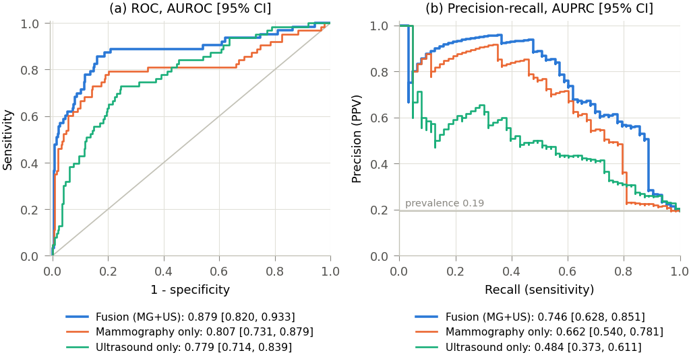
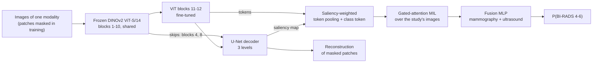
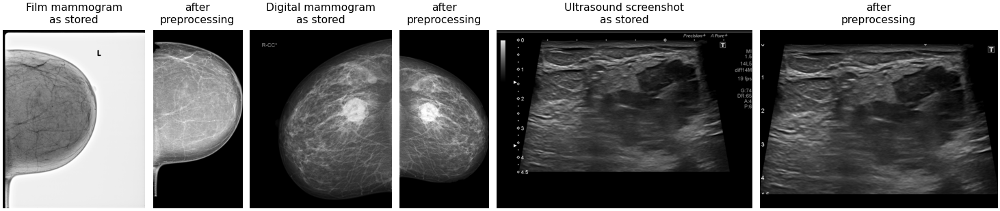
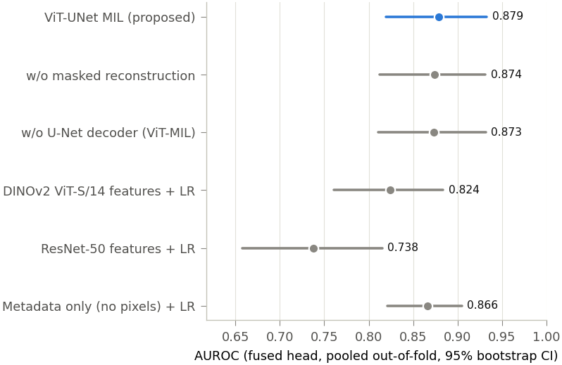
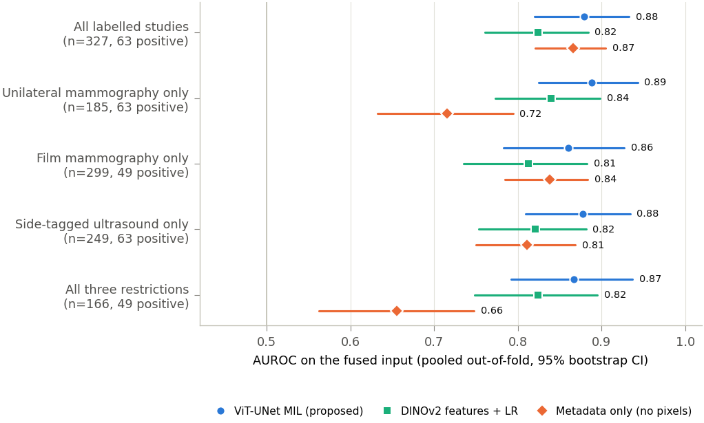
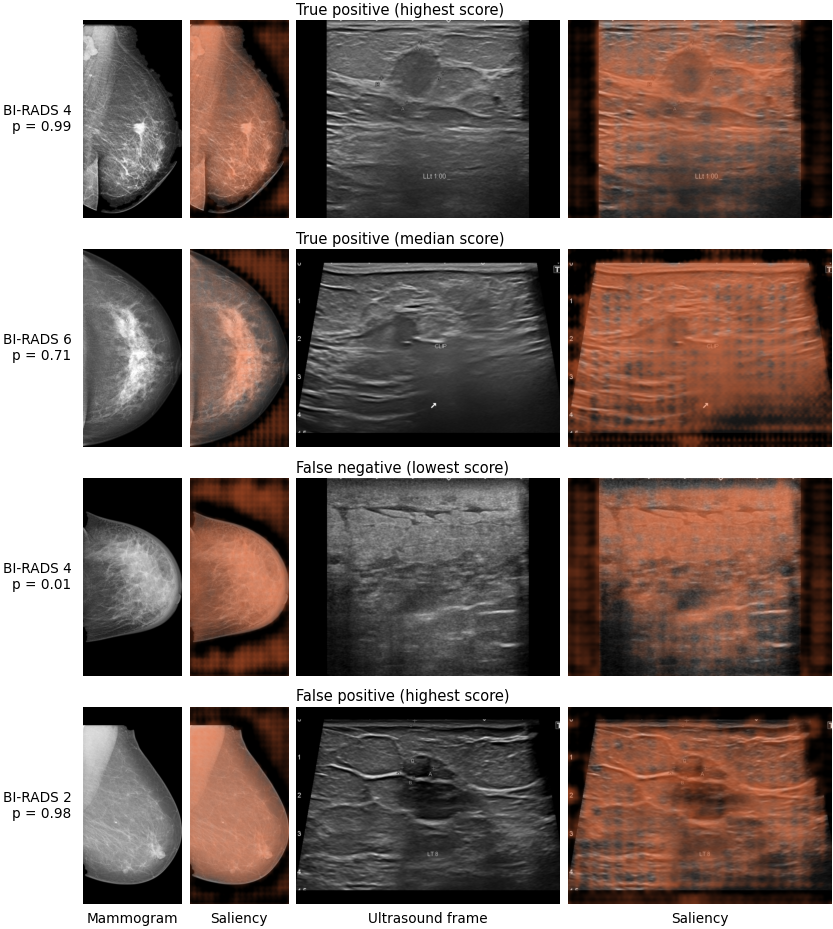
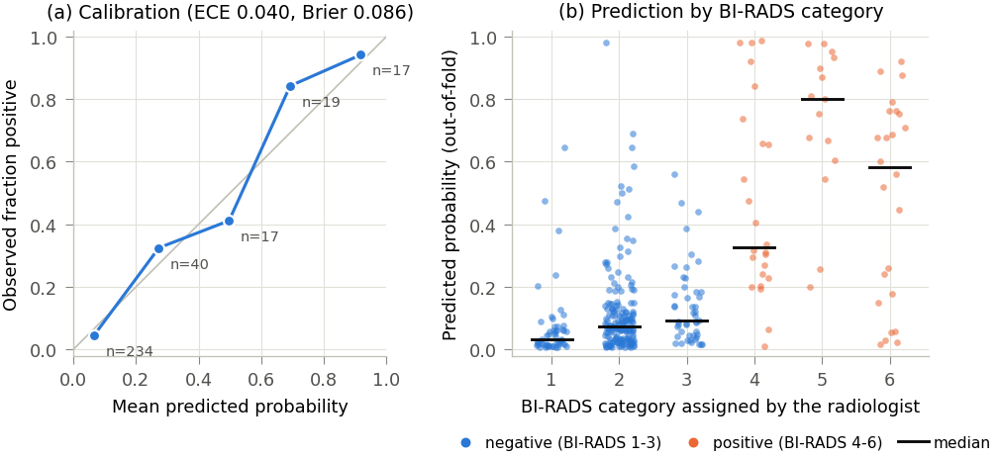

# ViT-UNet MIL on BCMID

Study-level prediction of a suspicious BI-RADS assessment (categories 4-6 vs 1-3) from paired mammography and
ultrasound, on the public [BCMID dataset](https://doi.org/10.5281/zenodo.19402690) (CC BY 4.0).



- `src/bcmid/` – preprocessing, model, training, evaluation
- `scripts/` – the pipeline, one numbered step per script
- `dashboard/app.py` – Streamlit dashboard with live inference
- `results/` – out-of-fold predictions, fold assignments, metrics
- `docs/figures/` – the figures shown on this page, written by steps 4 and 5
- `paper/` – not in this repository; steps 4 and 5 write figures, LaTeX tables and number macros here

**Research prototype. Not a medical device and not for clinical use.**

## Model

A frozen DINOv2 ViT-S/14 trunk is shared by a mammography branch and an ultrasound branch. Each branch
fine-tunes the last two transformer blocks and adds a three-level U-Net decoder fed from intermediate ViT
layers. BCMID has no segmentation masks, so the decoder is not trained to segment: one head reconstructs
masked image patches, the other produces a saliency map that weights the pooling of the ViT tokens. The images
of a study are pooled with gated-attention multiple-instance learning (MIL), and the two modalities are fused
by a small MLP.



The branch from the input to the MIL block exists once per modality.

## Preprocessing

BCMID mixes two mammography sources: film-type images stored with inverted grey levels, a grey frame and
burned-in view markers (875 images), and digital mammograms with standard polarity (76 images). Polarity is
detected automatically, the film frame is trimmed, and every mammogram is cropped to the breast with the chest
wall on the left. Ultrasound frames are scanner screenshots and are cropped to the scan area.



## Where the large files live

The raw archive (12.9 GB), the image cache and the checkpoints are kept outside the project, by default in
`~/bcmid_work` (`C:\Users\<you>\bcmid_work` on Windows). Set `BCMID_WORK_DIR` to use another location.

```text
bcmid_work/
  raw/BCMID.zip, BCMID_annotations.tsv
  processed/mg.npy, us.npy, manifest.csv, patients.csv, qa/
  runs/<variant>/fold{0..4}.pt
```

## Reproduce

```bash
pip install -r requirements.txt

python tools/download_bcmid.py ~/bcmid_work/raw        # archive + annotations; resumable, verifies both MD5s
python scripts/01_build_cache.py                       # crop / normalise all images (reads the zip directly)
python scripts/02_train_cv.py --variant full           # proposed model, 5-fold CV
python scripts/02_train_cv.py --variant no_decoder     # ablation: ViT + MIL without the U-Net decoder
python scripts/02_train_cv.py --variant no_recon       # ablation: decoder without masked reconstruction
# optional, not part of the reported results: --variant frozen (no fine-tuning of the last ViT blocks)
python scripts/03_baselines.py                         # frozen-feature + logistic-regression baselines
python scripts/04_report.py                            # metrics with CIs, figures, LaTeX tables and macros
python scripts/05_qualitative.py                       # saliency and preprocessing figures, statistics
```

Training one variant takes about 30 minutes on a 6 GB laptop GPU. Each fold is checkpointed, so an
interrupted run resumes where it stopped.

## Results in brief

Pooled out-of-fold predictions, 327 labelled studies (63 positive), 95% bootstrap confidence intervals.
Full tables are in `results/metrics_table.csv` and `results/summary.json`.

| Model (fusion of mammography + ultrasound) | AUROC |
| --- | --- |
| ViT-UNet MIL (proposed) | 0.879 (0.820-0.933) |
| without masked reconstruction | 0.874 (0.812-0.932) |
| without U-Net decoder (ViT + MIL) | 0.873 (0.811-0.932) |
| DINOv2 ViT-S/14 features + logistic regression | 0.824 (0.761-0.884) |
| ResNet-50 features + logistic regression | 0.738 (0.657-0.815) |
| **Metadata only, no pixels** + logistic regression | 0.866 (0.821-0.905) |



Three things to know before using these numbers.

### 1. The label is partly encoded in how studies were filed

All 142 bilateral (4-view) mammography studies are negative, all 78 studies with untagged ultrasound files
are negative, and the digital mammography system is 50% positive against 16% on film. A model that sees no
pixel reaches AUROC 0.866.

### 2. The image model is clearly better only inside acquisition-homogeneous subsets

Restricted to unilateral, film, side-tagged studies (166 studies, 49 positive), the proposed model scores
0.867 (0.792-0.937) against 0.655 (0.563-0.748) for metadata. On all studies the two are indistinguishable.



### 3. The U-Net decoder does not measurably help here

Removing it changes AUROC by 0.006 (95% CI -0.017 to +0.028). Its saliency maps are nearly uniform over the
tissue: the 10% most salient pixels carry about 12% of the weight, where 10% would be perfectly uniform. They
show where the model pools from and are not lesion maps. BCMID has no lesion masks to train the decoder on.

The four held-out studies below were chosen by a fixed rule (highest- and median-scoring true positive,
lowest-scoring false negative, highest-scoring false positive), each scored by the fold model that never saw
it. The orange tint is the saliency map, stretched per image for display.



### Calibration and BI-RADS categories

After Platt scaling on the validation splits, the fused probabilities have a Brier score of 0.086 and an
expected calibration error of 0.040. The model was trained on the binary label only, yet the median predicted
probability rises with the BI-RADS category from 1 to 5.



## Dashboard

```bash
streamlit run dashboard/app.py
```

Pages: dataset overview, model performance (ROC/PR, calibration, operating point, ablations, shortcut audit),
a case explorer that scores each study with the fold model that never saw it and overlays the decoder's
saliency map, and a page that runs the five-model ensemble on uploaded images.

## Figures and tables

Steps 4 and 5 write the figures on this page to `docs/figures/`. They also write print versions to
`paper/figures/` and the LaTeX tables and number macros to `paper/generated/`; that folder is ignored by git,
and the manuscript itself is not part of this repository.

## Evaluation protocol in one paragraph

Five-fold cross-validation, stratified by label and grouped by woman (a few women have one entry per breast).
Inside each training part, 20% of the studies are held out for epoch selection, Platt calibration and the
Youden threshold; the test fold is scored once. Metrics are computed on pooled out-of-fold predictions with
2,000-sample bootstrap confidence intervals. Hyperparameters were fixed in advance and not tuned on test folds.

## Image credit

The mammograms and ultrasound frames shown on this page come from BCMID (Seddik Tawfik et al., Zenodo, 2026,
[doi:10.5281/zenodo.19402690](https://doi.org/10.5281/zenodo.19402690)), licensed under CC BY 4.0, and are
shown cropped and intensity-normalised.
